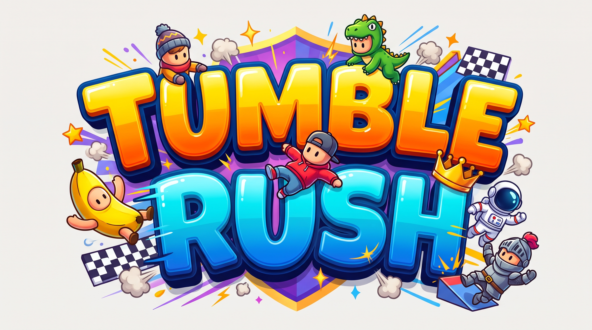

<p align="center">
  
</p>

# Tumble Rush — Temporada 1

Carrera de obstáculos en 3D estilo _Fall Guys_, hecha con **Godot Engine 4.7.2** (Forward Plus), **GDScript** y física **Jolt**.

El juego tiene **cinco circuitos**. Cuatro forman el **torneo de cuatro rondas** (Pivot Push → Spin Go Round → Glacier Gallop → Lava Vortex) y el quinto, **Abyss Run**, se corre en la carrera clásica. Cada circuito guarda su propio récord, sus medallas, sus checkpoints y su ruta de bots.

La última pasada añade los tres circuitos temáticos nuevos: el **glaciar** (hielo y muros de témpanos), el **volcán** (espiral con lava que sube, géiseres y lluvia de meteoros) y el **abismo** (túnel submarino con nado, islas y peligros marinos). También incorpora **cámara con ratón**, **nado** en Abyss Run y un kit de hazards temáticos. **Pivot Panic se retiró**: su escena ya no existe y su constructor quedó desactivado.

## Cómo ejecutar

1. Abre Godot 4.7.2 e importa la carpeta `proyecto/` (el archivo `project.godot`).
2. Pulsa **Play (F5)**.

## Generar un ejecutable

El proyecto incluye `proyecto/export_presets.cfg` con presets de _release_ para **Linux** y **Windows** (x86_64), ambos con el PCK incrustado, así que cada build es **un único archivo autocontenido**. Requiere las _export templates_ de Godot 4.7.2 instaladas.

```bash
godot --headless --path proyecto --export-release "Linux" exports/linux/TumbleRush.x86_64
godot --headless --path proyecto --export-release "Windows Desktop" exports/windows/TumbleRush.exe
```

Los artefactos quedan en `proyecto/exports/` (excluido de Git).

## Controles

| Acción                      | Teclado               | Mando                    |
| --------------------------- | --------------------- | ------------------------ |
| Moverse                     | `W A S D`             | Stick izquierdo          |
| Saltar                      | `Espacio`             | `A` / Cruz               |
| Girar la cámara             | Ratón                 | —                        |
| Nadar hacia abajo (Abyss)   | `Shift` / `Ctrl`      | Gatillo derecho          |
| Pausa                       | `Escape`              | `Start`                  |

El salto es de **altura variable**: mantener el botón salta más alto; soltarlo recorta el ascenso. No hay deslizamiento: la única forma de esquivar un obstáculo es correr y saltar. En el agua el corredor flota despacio y se impulsa con el stick; el gatillo derecho (o `Shift`/`Ctrl`) lo hunde.

## Características

### Circuitos

| Ronda | Circuito      | Escena                                  | Longitud | Checkpoints | Oro / Plata / Bronce |
| ----- | ------------- | --------------------------------------- | -------- | ----------- | -------------------- |
| 1     | Pivot Push    | `scenes/main.tscn`                      | 368 m    | 11          | 130 / 170 / 215 s    |
| 2     | Spin Go Round | `scenes/levels/spin_go_round.tscn`      | 339 m    | 12          | 115 / 145 / 185 s    |
| 3     | Glacier Gallop| `scenes/levels/glacier_gallop.tscn`     | 367 m    | 9           | 145 / 180 / 225 s    |
| 4     | Lava Vortex   | `scenes/levels/lava_vortex.tscn`        | 509 m    | 0           | 84 / 100 / 116 s     |
| —     | Abyss Run     | `scenes/levels/abyss_run.tscn`          | 428 m    | 6           | 112 / 138 / 172 s    |

- **Pivot Push** conserva los tramos originales y la forja: barridos, plataformas móviles, túneles de viento, cañón, balancín, péndulos, disco giratorio, lluvia de bolas, pasillo de rocas, terraza de pinchos, puente de aspas y bajada final.
- **Spin Go Round** es el circuito de obstáculos: arena de barridos, plataforma móvil sobre el vacío, peonzas y lluvia de bolas; subida con pistones y puente de losas frágiles; y un tercer acto con rocas persecutorias, galería de pinchos, puente de aspas, subida al mirador y bajada final.
- **Glacier Gallop** es el circuito de hielo: barridos y arena giratoria, ascensor de hielo, galería de pistones, puente de placas frágiles, puente del vendaval, pasillo de rocas y terraza de pinchos. Sus dos **muros de témpanos** (tres carriles que suben y bajan con aviso) son exclusivos, y el salto del jugador va recortado para que el hielo pese.
- **Lava Vortex** es una espiral de cuatro vueltas alrededor de una montaña: plataforma de salida, tres saltos sobre la lava, géiseres, lluvia de meteoros, vórtices de ceniza y cortinas de magma. No tiene checkpoints: la lava sube y una caída devuelve a la salida, así que el circuito se corre de una tirada.
- **Abyss Run** es la carrera clásica extra: un túnel submarino de 428 m con islas, zonas de agua, ascensores, pasos estrechos y peligros marinos (erizos, medusas, minas de burbujas, estrellas giratorias y aros de impulso). Se nada con flotabilidad y se bucea con el gatillo derecho.

### Personajes

- **Diez personajes animados del *Ultimate Animated Character Pack* de Quaternius (CC0)**: Chef, Obrero, Cowboy, Ninja, Pirata, Vikingo, Kimono, Soldado, Ejecutivo y Caballero. Todos traen idle, andar, andar con carrera acelerada, caída y celebración.
- **Dos cuerpos por personaje, un solo personaje**: cada entrada del catálogo trae su versión **masculina y femenina**. Se desbloquea una vez, ocupa una fila del menú y se elige una vez; el jugador corre siempre con uno de los dos cuerpos y los bots se reparten entre ambos.
- **Submenú Personaje** con una tarjeta por corredor, **vista previa 3D** girando y el estado de cada uno (elegido, libre o su precio).
- **Desbloqueos con monedas**: **Chef** es gratis y el resto cuesta de 200 a 1000 monedas; la compra se guarda en el perfil y el personaje equipado se usa en la siguiente carrera.
- **Bots con personaje y cuerpo aleatorios** entre todo el catálogo.
- **Flecha dorada única sobre la cabeza del jugador** (gira y flota) para distinguirlo de los bots.

### Movimiento y cámara

- **Coyote time** y **jump buffer** para que los saltos en bordes y las pulsaciones justas se sientan justas.
- **Hang en el ápice** con gravedad reducida y caída más rápida al bajar.
- **Herencia de velocidad** de plataformas móviles al saltar.
- **Aturdimiento** con pérdida temporal de control, estrellas, flash y sacudida.
- **Hitstop** y *slow motion* en impactos y meta.
- **Cámara con ratón**: el pivote gira con el movimiento del ratón durante la carrera (sensibilidad ajustable), con `SpringArm3D` para no atravesar paredes, FOV dinámico por velocidad/caída, *look-ahead* y sacudida ajustable.
- **Nado**: flotabilidad, arrastre, inclinación del cuerpo y control vertical con el gatillo derecho en Abyss Run.
- **Mando** con stick y botones A/X/Start.

### Carrera y progresión

- Carrera cronometrada con **cuenta atrás**, **splits por checkpoint** y comparación con el récord.
- **Checkpoints** con respawn y penalización (+2,5 s por caída); se marcan con una banda luminosa en el suelo, sin arco. Pivot Push tiene 11, Spin Go Round 12, Glacier Gallop 9, Abyss Run 6 y Lava Vortex ninguno.
- **Medallas oro/plata/bronce por circuito** (tabla de circuitos) y pantalla de **resultados** con tiempo, récord, medalla, splits, monedas y caídas.
- **Monedas según medalla, tiempo y puesto**, con el desglose visible en el panel de resultados.
- **Perfil persistente** en `user://profile.json`: récord y splits por circuito, medallas, monedas, estadísticas, ajustes, personaje y tutorial. Migra automáticamente el antiguo `user://best_time.save` y el perfil de las carpetas de datos de versiones anteriores.
- **Tutorial** de primera vez y **menú de pausa** con reinicio desde checkpoint, reinicio de carrera y ajustes.

### Modos

- **Carrera clásica**: contrarreloj y récord personal en **el circuito que elijas**. El panel de modos lista los **cinco** circuitos con su nombre real; el elegido queda marcado y se guarda en el perfil. Cada circuito conserva su propio récord, sus medallas y sus checkpoints.
- **Torneo con bots**: **cuatro rondas** (Pivot Push → Spin Go Round → Glacier Gallop → Lava Vortex). Empieza con 7 bots y clasifican los 3 primeros; cada ronda añade un bot (hasta 11), sube un 5 % su velocidad y reduce las plazas (3 → 3 → 2 → 1). El torneo termina en la final.
- **Bots que caen como el jugador**: siguen la ruta de cada circuito, esperan a plataformas, barridos y péndulos, esquivan las bolas y se apartan de los carriles peligrosos. Cuando uno **cae al vacío vuelve a su último checkpoint**, nunca al que perseguía. Solo si el tramo se le atraganta dos veces (o se queda atascado sin caerse) recibe un empujón de seguridad, para que la carrera no se quede colgada. **Los obstáculos les afectan igual**: el túnel de viento los arrastra de lado, el cañón dispara en el momento en que pisan el gatillo y la tabla volcada del balancín los desliza como al jugador.

### Contenido y obstáculos

- **17 escenas de obstáculo reutilizables**: barrido, péndulo, plataforma giratoria, pistón, losa frágil, roca persecutoria, trampa de pinchos, aspa giratoria, muro, trampolín, plataforma móvil, bola, dispensador de bolas, cinta, túnel de viento, cañón y balancín.
- **Hazards temáticos de los circuitos nuevos**:
  - **Glaciar**: muros de témpanos por carriles, nieve y niebla.
  - **Volcán**: lava que sube, géiseres, lluvia de meteoros, vórtice de ceniza y cortinas de magma.
  - **Abismo**: zonas de agua con franja de nado, erizos, medusas, minas de burbujas, estrellas giratorias y aros de impulso.
- Los tres circuitos temáticos se generan con `scripts/level_builder.gd` (modo `@tool`): al abrir la escena se construye el mapa, y al guardarla queda horneado en el `.tscn` y se edita como cualquier otro. Abyss Run se genera en runtime porque su escena solo contiene el constructor.

### Arte y presentación

- **Shaders propios**: toon de bandas + rim + brillo de globo (`toy.gdshader`) en obstáculos y multitud; el mismo acabado plástico en los corredores (`character.gdshader`); suelos con rejilla, vetas y barrido de energía (`platform.gdshader`); mar de nubes animado bajo el circuito (`void_sea.gdshader`).
- **Postproceso** en tiempo real: viñeta, grano, aberración cromática, *split-toning* frío/cálido, desenfoque radial al correr, líneas de velocidad, dithering, tinte de aturdimiento y flash de impacto.
- **Cielo procedural** con sol, halo cálido y **dos capas de nubes** a distinta velocidad; niebla volumétrica, SSAO, SSIL, bloom y ajuste de color. Cada circuito tiene su paleta: Pivot Push (azul real/magenta/oro), Spin Go Round (cian/naranja), Glacier Gallop (hielo/cian), Lava Vortex (negro/rojo/naranja) y Abyss Run (turquesa/arena/coral).
- **Personajes 3D descargados**: los 20 cuerpos del *Ultimate Animated Character Pack* de Quaternius (CC0), GLB con esqueleto y animaciones. El catálogo renombra los clips al vuelo, el jugador usa el que elige en el menú, los bots reciben personaje y cuerpo al azar y todos se escalan a la misma altura. La animación suma una **capa procedural** (`scripts/character_rig.gd`): torso inclinado al esprintar, piernas y brazos recogidos en el salto y flexión al aterrizar.
- **Escenografía procedural** alrededor de cada circuito: mar de nubes, islas flotantes, anillos de neón, montañas lejanas, gradas con multitud (`MultiMeshInstance3D`), guirnaldas y soportes en cada plataforma.
- **UI pegatina 3D en el lobby y los menús**: degradado neón, paneles violeta con borde blanco y sombra sólida, botones amarillos y cian inclinados, tipografía **Baloo 2 ExtraBold** con contornos. El HUD de carrera conserva el tema oscuro.
- **Lobby principal**: barra superior con logotipo, navegación y monedas, **tarjeta de temporada** con progreso hacia el oro y el récord, **escaparate 3D** del corredor equipado girando sobre su peana y un botón **JUGAR!** magenta que abre las dos tarjetas de modo (carrera clásica y torneo). Al terminar cada carrera suena la canción de victoria.

## Estructura

```
proyecto/
├── audio/                  # Tema del menú, canción de victoria y 15 SFX
├── assets/characters/      # 20 cuerpos GLB CC0 de Quaternius + licencia
├── assets/props/           # Pelota de playa CC-BY de Poly Pizza + licencia
├── materials/              # Materiales toy/platform (shaders) por color
├── shaders/                # postproceso, cielo, toon, plataformas y mar
├── ui/                     # tema compartido y tipografía Baloo 2 (OFL)
├── scenes/
│   ├── main.tscn           # Pivot Push (ronda 1) + jugador + HUD + pausa
│   ├── levels/             # Spin Go Round, Glacier Gallop, Lava Vortex y Abyss Run
│   ├── menu/               # menú principal, pausa y ajustes
│   ├── obstacles/          # 17 obstáculos interactivos
│   ├── player/player.tscn  # corredor con personaje 3D y cámara
│   ├── race/               # checkpoint, meta, HUD, kill plane, bot
│   └── ui/                 # (reservada para UI adicional)
├── exports/                # Builds generados (excluido de Git)
├── scripts/                # Un script por responsabilidad + autoloads
└── tools/                  # Tests headless, generador de audio y de niveles
```

## Verificación

Los tests headless se ejecutan desde `proyecto/` (o todos de una vez con `tools/run_tests.sh`):

```bash
cd proyecto
godot --headless -s res://tools/check_scenes.gd       # RESULT: 31/31 scenes OK
godot --headless -s res://tools/smoke_test.gd         # SMOKE OK
godot --headless -s res://tools/flow_test.gd          # RESULT: TODO OK
godot --headless -s res://tools/features_test.gd      # RESULT: TODO OK
godot --headless -s res://tools/iteration3_test.gd    # RESULT: TODO OK
godot --headless -s res://tools/iteration4_test.gd    # RESULT: TODO OK
godot --headless -s res://tools/iteration5_test.gd    # RESULT: TODO OK
godot --headless -s res://tools/levels_test.gd        # RESULT: TODO OK
godot --headless -s res://tools/persistence_test.gd   # RESULT: TODO OK
godot --headless -s res://tools/progression_test.gd   # RESULT: TODO OK
godot --headless -s res://tools/settings_test.gd      # RESULT: TODO OK
godot --headless -s res://tools/levels_bots_test.gd   # no termina en 280 s (ver abajo)
godot --headless -s res://tools/bots_test.gd          # no re-ejecutado en esta pasada
```

**Fallos conocidos de la batería** (comprobaciones desfasadas, no regresiones del juego):

- `levels_bots_test.gd` — lanza el test de bots de los circuitos nuevos, pero no termina dentro de 280 s en esta máquina (código 124) y al salir deja avisos de RIDs de `NavMesh` sin liberar. No se considera un test en verde.
- `bots_test.gd` — no se ha vuelto a ejecutar en esta pasada; su última referencia es la del informe anterior.

> Los tests asumen que el proyecto ya se ha abierto una vez en Godot para importar las escenas y los WAV nuevos. Ejecutar sin esa caché puede hacer que `ResourceLoader.exists()` no encuentre los SFX recién generados (el juego sigue funcionando, simplemente sin ese sonido).

## Arquitectura

- **Autoloads:**
  - `SaveManager` — perfil JSON, ajustes, monedas, medallas y migración del récord.
  - `GameSession` — modo (clásico/torneo), ronda, circuito elegido y bindings de mando.
  - `GameFeel` — hitstop, slow motion, sacudida y flash globales.
  - `AudioManager` — tema del menú, **canción de victoria** + pools de SFX 2D/3D con buses `Music`/`SFX`/`Victory`, pitch variable y degradación elegante.
  - `TransitionManager` — fades entre escenas y reset de `GameFeel`.
- **Señales:** `RaceManager` emite `time_updated`, `split_reached`, `checkpoint_reached`, `finished`, `respawned`, `best_time_updated`, `checkpoints_updated`, `countdown_tick`, `race_started` y `results_ready`; el HUD se suscribe.
- **Grupos:** `player`, `bot`, `bots`, `checkpoints`, `race_manager`, `race_director`, `pause_menu`, `wind_tunnels`, `launchers`, `see_saws`, `level_info`.
- **Datos:** `user://profile.json` (perfil, personaje elegido, personajes desbloqueados, monedas, récords y splits por circuito, ajustes) y `user://best_time.save` (solo legado, se importa una vez).
- **Circuitos:** cada escena lleva un nodo `LevelInfo` con id, nombre, ronda, longitud, tiempos de medalla, récord por nivel, ruta de bots y carriles. `RaceManager`, `RaceDirector` y el HUD leen ese contrato, así que el mismo jugador y el mismo bot funcionan en todos los mapas.

## Audio

Todo el audio se sintetiza desde cero con `tools/generate_audio.py`:

```bash
cd proyecto
python tools/generate_audio.py
```

Genera el tema alegre del menú (`menu_theme.wav`, 38 s en bucle) y **15 SFX**: salto, paso, checkpoint, meta, caída, aterrizaje, impacto, moneda, UI, cuenta atrás, viento, cañón, crujido del balancín, trampolín y whoosh de martillos. La música **solo suena en el menú**; durante la carrera se detiene y dejan oírse los pasos, los bots y los obstáculos, estos últimos con audio 3D atenuado por distancia. Al cruzar la meta suena `audio/music/victory.mp3` (**22 s**, recortado y normalizado) sobre el panel de resultados. Va por su propio bus `Victory`, así que se oye aunque el volumen de música esté bajo.

## Documentación

- `documentacion/Primera_entrega.md` — Informe de la primera entrega.
- `documentacion/Segunda_iteracio.md` — Informe de la segunda entrega de seguimiento: los cinco circuitos, el torneo de cuatro rondas y la verificación real.
- `documentacion/Torneo_cuatro_circuitos.md` — Los cuatro circuitos del torneo, paletas, rutas, récords, verificación y créditos de las referencias.
- `documentacion/Ideas_Mejora.md` — Banco de ideas para futuras iteraciones.

## Créditos

- Autores: **Pol Arjona** e **Yazan Issa**
- Motor: [Godot Engine](https://godotengine.org) 4.7.2
- Pelota de playa: [beach ball](https://poly.pizza/m/4IwPTeOmq6c) de **the_ normalgamer**, licencia **CC-BY 3.0** (ver `proyecto/assets/props/README.md`).
- Referencias de mapa: [Pivot Push](https://sketchfab.com/3d-models/stumble-guys-pivot-push-map-c7abc0bdd0a8490d9f1e9c805e3c05cd) y [Spin Go Round](https://sketchfab.com/3d-models/stumble-guys-spin-go-round-map-71224cc13db44948b91b8bb43c635d5c) de **amogusstrikesback2**, **CC-BY 4.0**; usadas solo como referencia de composición y color, sin redistribuir sus mallas.
- Personajes 3D: [Ultimate Animated Character Pack](https://quaternius.com/packs/ultimatedanimatedcharacter.html) de [Quaternius](https://quaternius.com), licencia **CC0** (ver `proyecto/assets/characters/ultimate/LICENSE_Quaternius.txt`).
- Tipografía: [Baloo 2](https://fonts.google.com/specimen/Baloo+2) de Ek Type, licencia **SIL OFL 1.1** (ver `proyecto/ui/fonts/OFL-Baloo2.txt`).
- IA usada en el desarrollo (ver informe en `documentacion/`).
