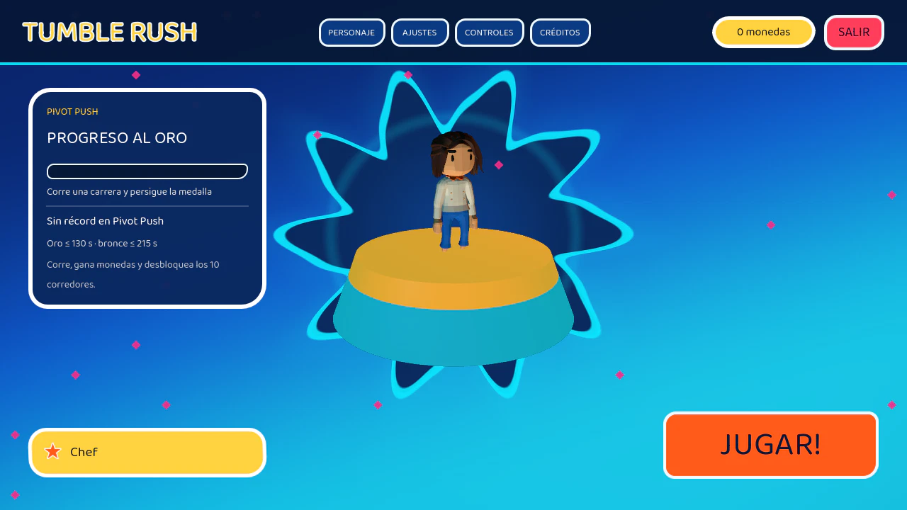
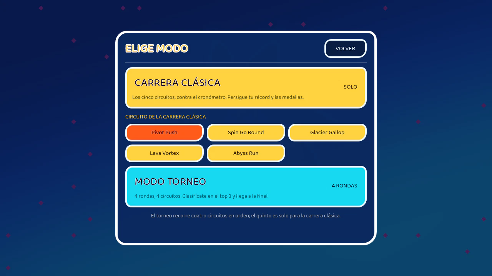
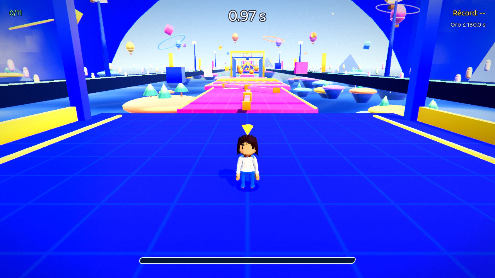
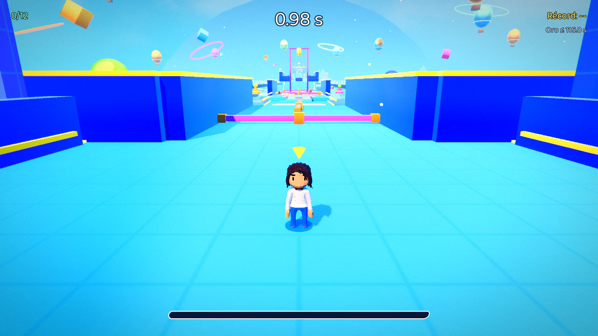
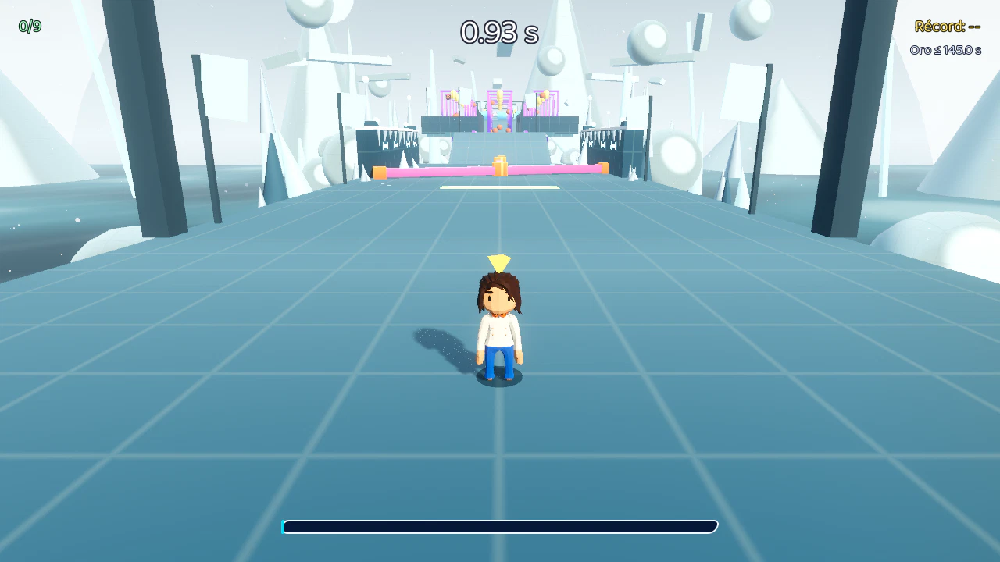
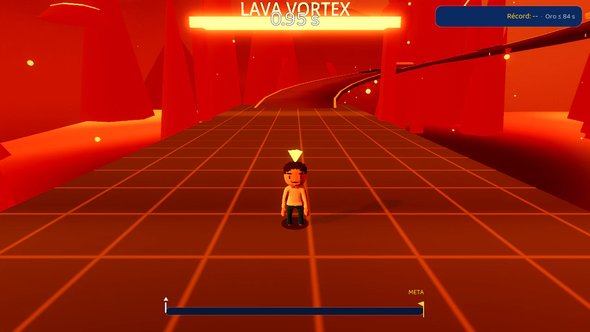
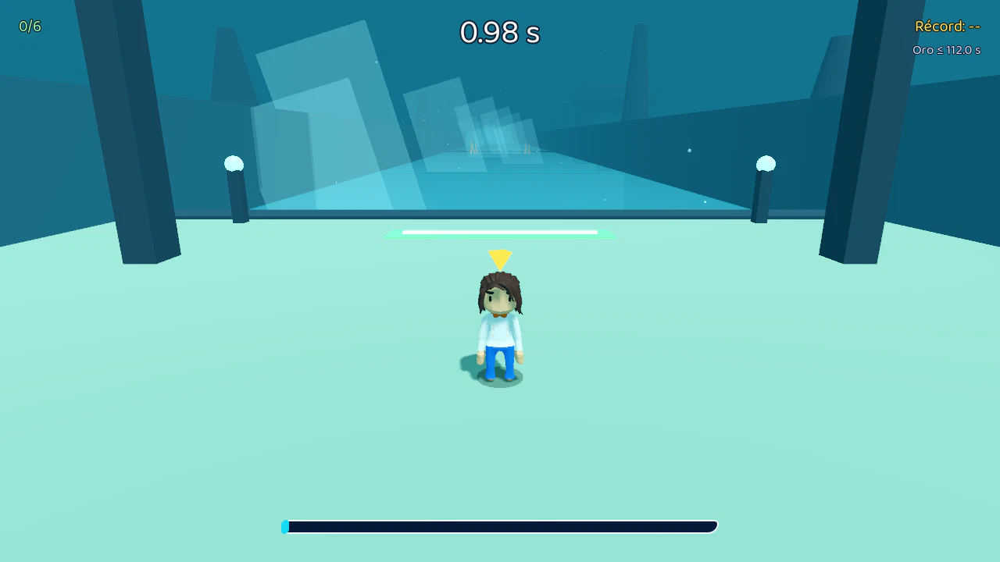
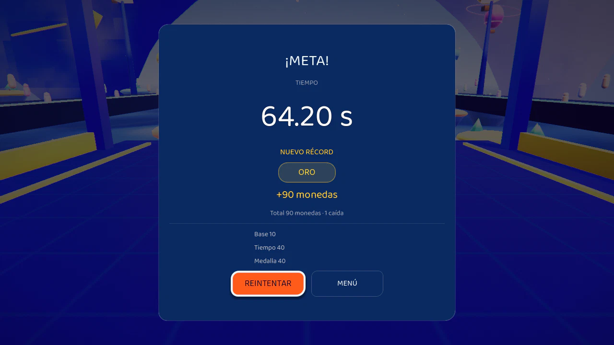
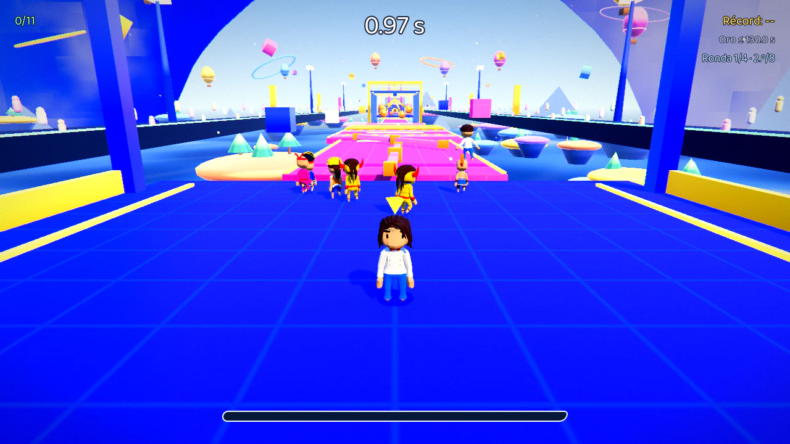

# Capturas propias

Todas las imágenes están generadas con el render real del juego mediante [`proyecto/tools/capture_docs.gd`](../proyecto/tools/capture_docs.gd). Se usó un perfil aislado para no tocar el progreso del jugador; por eso algunas pantallas muestran datos de demostración, no una partida real.

| Archivo | Estado | Qué muestra |
| --- | --- | --- |
| `menu_principal.webp` | Menú | Lobby con la ruta de cinco circuitos, el corredor equipado y las dos tarjetas de modo. |
| `menu_torneo.webp` | Menú | Lobby con la tarjeta de torneo enfocada, sin panel modal. |
| `pivot_push.webp` | Circuito | Salida de Pivot Push con el HUD de chips y la barra con meta, marcador y checkpoints. |
| `spin_go_round.webp` | Circuito | Vista de Spin Go Round con sus obstáculos de suelo. |
| `glacier_gallop.webp` | Circuito | Vista del glaciar con hielo, nieve y niebla. |
| `lava_vortex.webp` | Circuito | Espiral del volcán con lava y atmósfera rojiza. |
| `abyss_run.webp` | Circuito | Túnel submarino de Abyss Run con islas y agua. |
| `resultados.webp` | Resultados | Tiempo como protagonista, chip de medalla, monedas y recibo del desglose. |
| `torneo_carrera.webp` | Torneo | Salida de una carrera de torneo con bots. |

Todas son **WebP de 1280 × 720** y se regeneran desde `proyecto/` con `capture_docs.gd`. En `resultados.webp` el tiempo de **64,20 s**, la caída y el estado del perfil son sintéticos: el script los fija para que la captura sea reproducible. En `torneo_carrera.webp`, `Récord: --` indica que el perfil aislado todavía no tiene una marca guardada; no es un fallo del HUD.

## Menú

  
  

## Circuitos

### Pivot Push

### Spin Go Round

### Glacier Gallop

### Lava Vortex

### Abyss Run

## Resultados y torneo

  
  

Las capturas de `documentacion/referencias/` son otra cosa: son las vistas previas de los mapas ajenos que se usaron como referencia de composición y color, no pantallazos de este proyecto.
