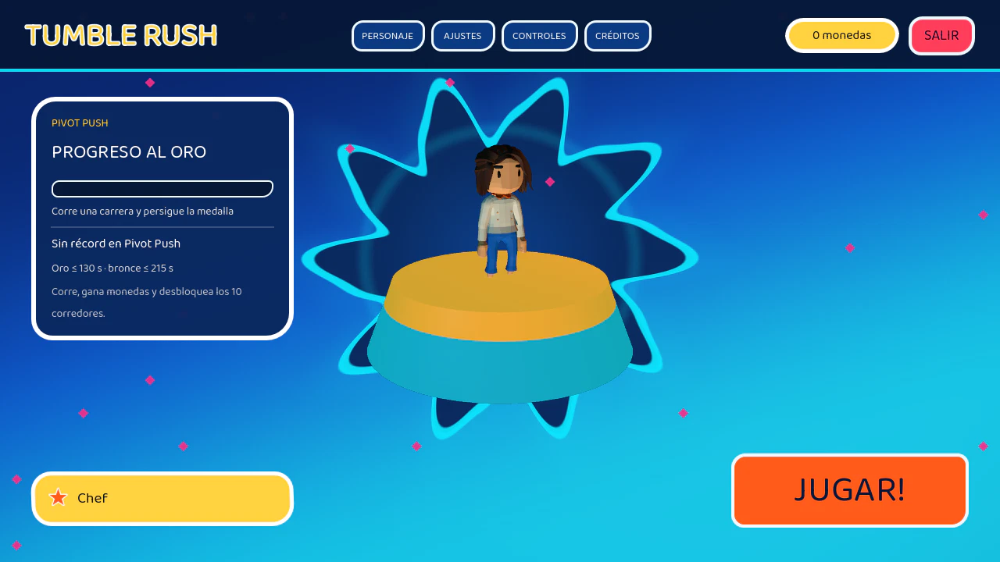
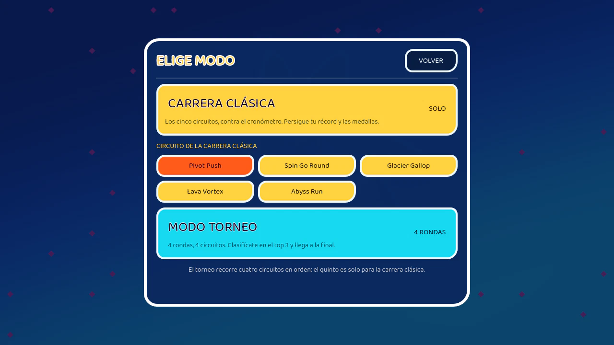
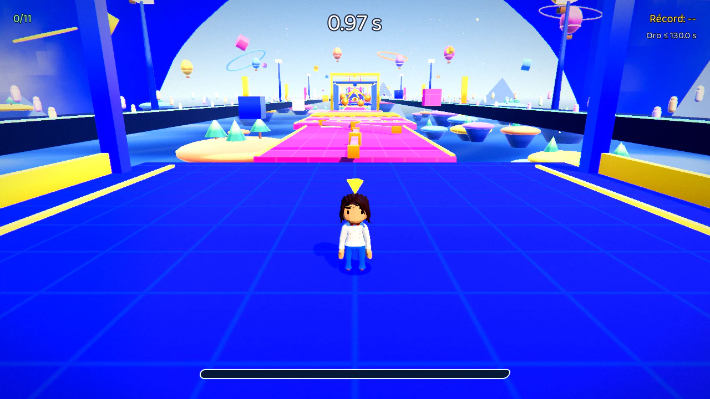
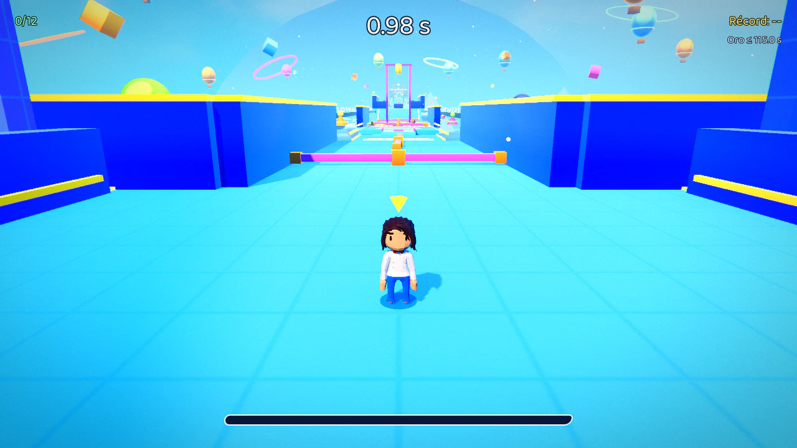
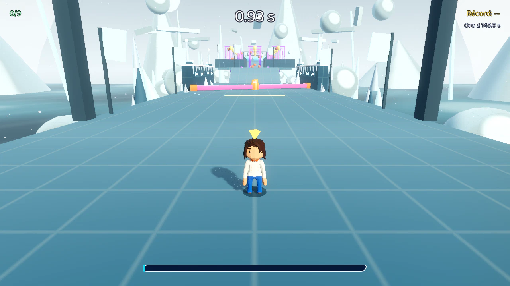
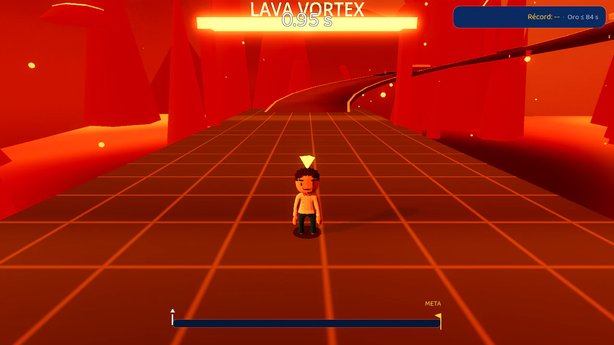
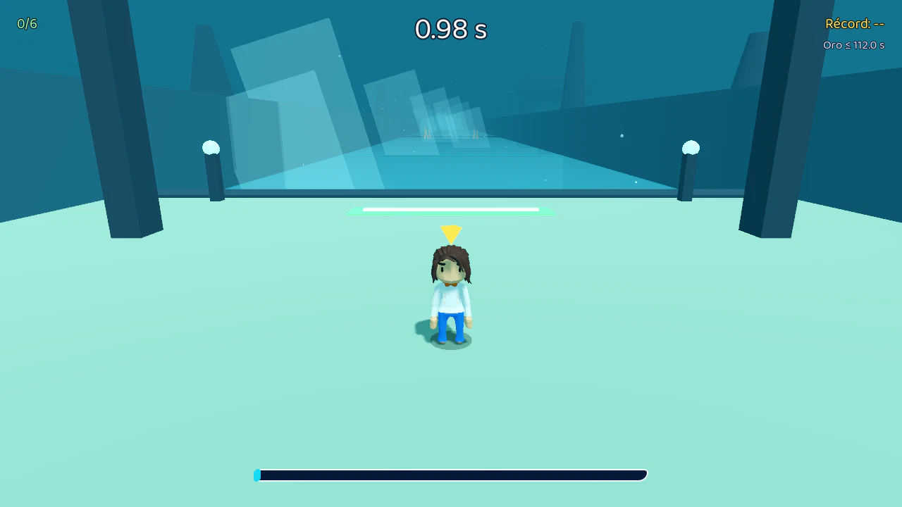
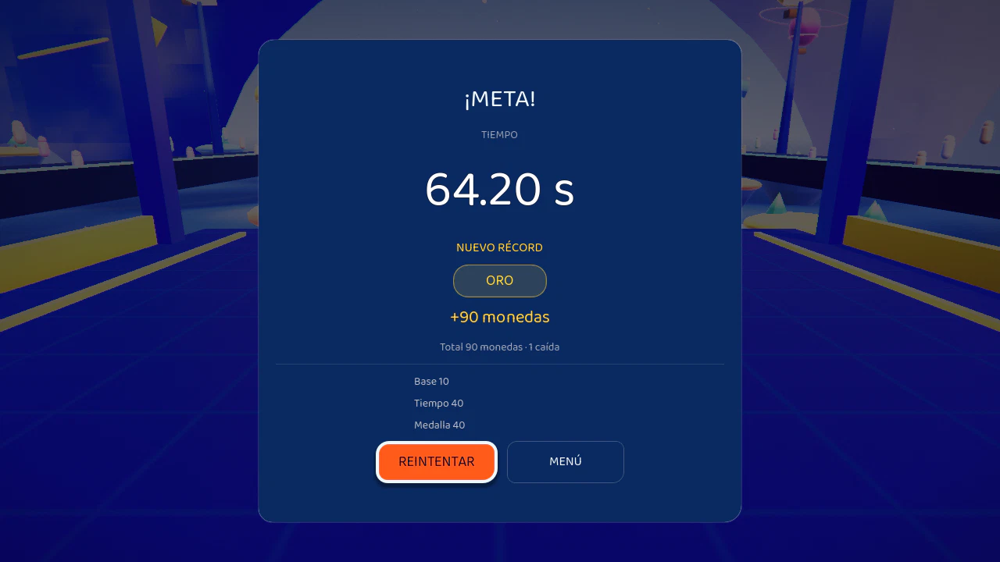
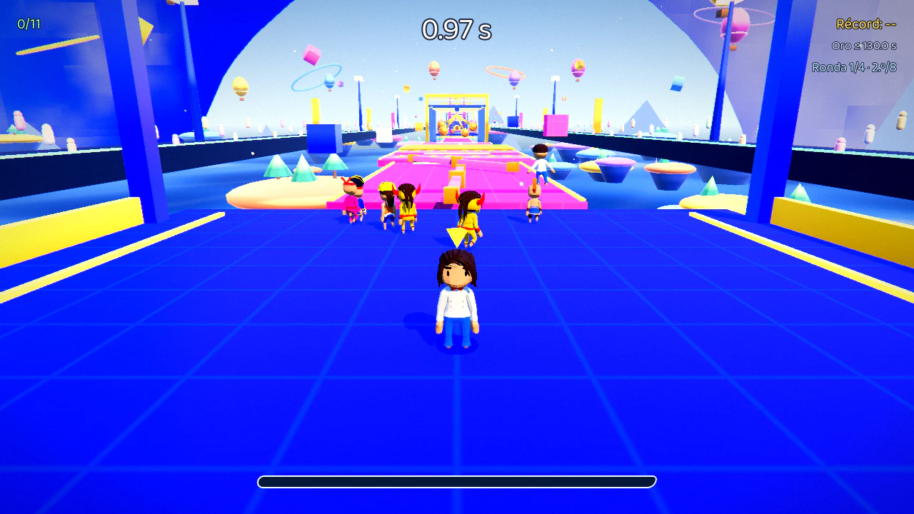

# Informe de Seguimiento — Segunda Entrega

**Proyecto:** Tumble Rush
**Autores:** Pol Arjona e Yazan Issa
**Motor:** Godot Engine 4.7.2 (Forward Plus, física Jolt)
**Lenguaje:** GDScript
**Fecha:** Noviembre 2026

---

## 1. Estado de la entrega

El juego ya no es un circuito único con bots: es una temporada de circuitos con dos formas de jugarlos.

- **Torneo por rondas:** Pivot Push → Spin Go Round → Glacier Gallop → Lava Vortex.
- **Carrera clásica:** permite elegir cualquiera de los circuitos, incluido **Abyss Run**, el submarino.

Cada circuito tiene su propia escena, su `LevelInfo` (id, nombre, ronda, longitud, tiempos de medalla, ruta de bots y anchos de carril), su récord, sus medallas y sus checkpoints. `GameSession` es quien decide qué mapa se carga según el modo y la ronda, y el menú recuerda el circuito elegido para la carrera clásica.

La tabla vigente de longitudes, checkpoints y medallas está en [Datos de referencia](Datos_circuitos.md#circuitos). Este informe ya no la copia: cualquier cambio se hace solo allí.

**Pivot Panic se retiró.** Su escena ya no existe y su constructor quedó desactivado en `tools/build_levels.gd`; el torneo se cerró con los circuitos actuales.

---

## 2. Los circuitos

El [informe del torneo](Torneo_cuatro_circuitos.md) es la referencia detallada de actos, obstáculos y cifras de producción. Aquí queda el resumen de la temporada:

- **Pivot Push (ronda 1):** circuito original retematizado en azul, magenta y oro; conserva los tramos clásicos y la forja del tercer acto.
- **Spin Go Round (ronda 2):** el circuito con más obstáculos de suelo; alterna arena, peonzas, altura, persecuciones y mirador.
- **Glacier Gallop (ronda 3):** hielo con barridos, ascensores, placas frágiles y muros de témpanos; el salto del jugador va recortado.
- **Lava Vortex (ronda 4):** espiral alrededor del volcán con lava ascendente, géiseres, meteoros, ceniza y magma; no tiene checkpoints.
- **Abyss Run (clásica):** túnel submarino con islas, zonas de agua, nado y hazards marinos; no entra en el torneo.

### Capturas propias

Todas las imágenes salen del render real del juego. Se generaron con [`proyecto/tools/capture_docs.gd`](../proyecto/tools/capture_docs.gd) y un perfil aislado; la galería completa está en [Capturas](Capturas.md).

<p align="center">
  
  
</p>
<p align="center">
  
  
</p>
<p align="center">
  
  
</p>
<p align="center">
  
  
</p>
<p align="center">
  
</p>

---

## 3. Mecánicas y sistemas

### 3.1 Movimiento y cámara

Se mantiene el paquete de *game feel* de la iteración anterior: coyote time, jump buffer, ápice flotante, herencia de velocidad de plataformas, aturdimiento, hitstop y *slow motion*.

La novedad es la **cámara con ratón**: durante la carrera el puntero se captura y el pivote gira con el movimiento del ratón, con cabeceo limitado (-75° a 15°), sensibilidad ajustable desde Ajustes y `SpringArm3D` para no atravesar paredes. El FOV sigue subiendo con la velocidad y la caída.

### 3.2 Nado

`player.gd` incorpora un modo de nado que activan las zonas de agua:

- flotabilidad tenue (sin tocar nada se sube despacio),
- arrastre que frena la inercia,
- inclinación del cuerpo,
- control vertical con el gatillo derecho o `Shift`/`Ctrl`,
- franja vertical de la zona para no salirse por arriba ni por abajo.

### 3.3 Kit de hazards temáticos

Además de los obstáculos reutilizables (recuento en [Datos de referencia](Datos_circuitos.md#recuentos-de-contenido)), los circuitos nuevos añaden scripts propios:

| Circuito | Hazard | Qué hace |
| --- | --- | --- |
| Glaciar | Muro de témpanos (`ice_rampart.gd`) | Bloques que emergen por carriles, con aviso y ciclo |
| Glaciar | Nieve (`snowfall.gd`) y niebla | Ambiente y lectura de profundidad |
| Volcán | Lava que sube (`lava_rise.gd`) | Superficie que asciende y persigue al corredor |
| Volcán | Géiser (`lava_geyser.gd`) | Columna que empuja hacia arriba |
| Volcán | Lluvia de meteoros (`meteor_rain.gd`) | Impactos con aviso previo |
| Volcán | Vórtice de ceniza (`ash_vortex.gd`) | Zona que arrastra |
| Volcán | Cortina de magma (`magma_curtain.gd`) | Chorro vertical que corta el paso |
| Abismo | Zona de agua (`water_zone.gd`) | Activa el nado y fija la franja |
| Abismo | Fauna y trampas (`ocean_hazards.gd`) | Erizos, medusas, minas, estrellas y aros de impulso |

### 3.4 Bots y torneo

- La configuración de bots, plazas y velocidad por ronda está en [Datos de referencia](Datos_circuitos.md#configuracion-del-torneo).
- Los bots siguen la ruta de cada circuito, esperan plataformas y barridos, esquivan rocas y bolas y reciben los hazards como el jugador.
- Una caída devuelve al bot a **su último checkpoint**, no al que perseguía. El empujón de seguridad solo aparece si el tramo se le atraganta dos veces o se queda atascado.

### 3.5 Perfil, monedas y medallas

- Perfil JSON versionado en `user://profile.json`, con récord y splits **por circuito**, medallas, monedas, estadísticas, ajustes, personaje y tutorial.
- Migración automática del antiguo `user://best_time.save` y de perfiles de versiones anteriores.
- Monedas por medalla, tiempo y puesto, con desglose en el panel de resultados.
- Ajustes de volumen de música/SFX, intensidad de sacudida, sensibilidad de ratón y pantalla completa.

### 3.6 Personajes, lobby y audio

- **Personajes CC0 de Quaternius** con cuerpo masculino y femenino, animaciones de idle, andar, caída y celebración, más una capa procedural de esprint, salto y aterrizaje. El catálogo y sus recuentos están en [Datos de referencia](Datos_circuitos.md#recuentos-de-contenido).
- **Lobby** con escaparate 3D del corredor equipado, ruta de circuitos con medallas, las dos tarjetas de modo siempre visibles, monedas y panel de personajes (también se abre al clicar al corredor) con compra y vista previa.
- **Audio:** tema de menú, canción de victoria en bus propio y SFX sintetizados con `tools/generate_audio.py` (recuento en [Datos de referencia](Datos_circuitos.md#recuentos-de-contenido)).

---

## 4. Arquitectura y generación de niveles

- **Autoloads:** `SaveManager` (perfil), `GameSession` (modo, ronda y circuito), `GameFeel` (hitstop/sacudida), `AudioManager` (música y SFX) y `TransitionManager` (fades).
- **Contrato de circuito:** cada escena lleva un `LevelInfo` con id, nombre, ronda, longitud, tiempos de medalla, meta, ruta de bots, anchos de carril y punto de salida. `RaceManager`, `RaceDirector` y el HUD lo leen sin conocer el mapa.
- **Escenas horneadas:** Pivot Push y Spin Go Round están construidas a mano y guardadas como `.tscn`.
- **Generador `@tool`:** `scripts/levels/level_builder.gd` construye Glacier Gallop, Lava Vortex y Abyss Run. Al abrir la escena en el editor se genera el mapa; al guardar, los nodos quedan marcados con `owner` y el `.tscn` queda horneado y editable. Si la escena ya tiene contenido, el generador no reconstruye nada.
- **Abyss Run:** funciona como los demás circuitos generados: su escena instancia `abyss_run_act1..3.tscn`, que salen del generador horneado. El túnel no se genera en runtime.
- **Rendimiento:** los mapas hechos a mano ya no usan CSG; los circuitos generados se guardan en actos (`_act1..3.tscn`); la sombra de contacto y el raycast del suelo de la cámara se refrescan a menos frecuencia que la física; el dispensador de bolas recicla sus `RigidBody3D`; el menú templa los shaders de los obstáculos; y cada acto recorta su atrezo a distancia y convierte sus losas grandes en occluders (`scripts/level_lod.gd`).
- **Grupos:** `player`, `bot`, `bots`, `checkpoints`, `race_manager`, `race_director`, `pause_menu`, `wind_tunnels`, `launchers`, `see_saws` y `level_info`.

---

## 5. Verificación

La batería se ejecuta desde `proyecto/` con `tools/run_tests.sh`, que corta cada test por tiempo y publica un resumen:

```bash
cd proyecto
bash tools/run_tests.sh          # suite obligatoria
bash tools/run_tests.sh --long   # tests largos de bots
```

El resultado vigente y el recuento de tests están en [Datos de referencia](Datos_circuitos.md#verificacion).

**Tests largos** (`tools/run_tests.sh --long`, job aparte en la CI):

- `bots_test.gd` — **TODO OK**: los bots se reparten en carriles, avanzan y completan el circuito.
- `slow_test.gd` — **TODO OK**: los hazards frenan al corredor y al bot, y el frenazo caduca solo.
- `levels_bots_test.gd` — **TODO OK**: el bot completa Spin Go Round, Glacier Gallop y Lava Vortex. Los tiempos están en [Datos de referencia](Datos_circuitos.md#verificacion). La prueba corre sin jugador en la escena: si se queda quieto, la lava lo quema a los pocos segundos, `fail_race()` congela la carrera y los bots se paran, que es justo lo que no se quiere medir.

Los tests asumen que el proyecto ya se ha abierto una vez en Godot para importar escenas y WAV nuevos.

---

## 6. Incidencias y decisiones

- **Pivot Panic fuera del torneo.** Su escena y su constructor se retiraron para cerrar el torneo con los circuitos actuales; las referencias a Pivot Panic que quedaban en la documentación se han eliminado.
- **Lava Vortex sin checkpoints.** La subida de lava convierte cada caída en un reinicio completo; por eso el circuito no tiene puntos de control y sus medallas son las más ajustadas del juego.
- **Dive restaurado para nadar.** El dive como mecánica de carrera sigue fuera, pero la acción de entrada se reutiliza para descender en el agua. Eso invalida una comprobación de `iteration3_test`.
- **Saltos y alturas del glaciar.** El jugador lleva un impulso de salto recortado para que el hielo se note; el resto del control no cambia.
- **Generación y horneado.** El generador `@tool` permite reconstruir un circuito temático sin copiar escenas gigantes, y el horneado deja el mapa editable y estable para los tests.
- **Documentación alineada.** README, este informe y el informe del torneo describen los circuitos y el torneo; la Tercera Iteración se retira de la entrega y queda para una futura iteración.
- **Documentación y CI puestas al día.** Los informes citaban cifras que ya no eran ciertas; ahora las cifras vigentes viven en [Datos de referencia](Datos_circuitos.md) y la CI no deja fuera ningún test: `tools/run_tests.sh` corta cada test por tiempo y el workflow tiene dos jobs (suite obligatoria y tests largos), además de caché de Godot y de la importación.
- **El falso bucle del bot en Lava Vortex.** El test de bots de los circuitos dejaba al jugador quieto en la escena. La lava sube, lo quema a los pocos segundos, `fail_race()` llama a `freeze_race()` y el director apaga la física de todos los bots: lo que parecía un bot atascado en un waypoint de la espiral era la carrera congelada esperando al tope de frames del test. Ahora la prueba quita el jugador de la escena y el bot sube la espiral entera (Lava Vortex y un rescate).

---

## 7. Uso de inteligencia artificial

En esta iteración la IA (Freebuff, de Codebuff) se ha utilizado para:

- Revisar el estado real del proyecto frente a la documentación y localizar las contradicciones (circuitos que faltaban, Pivot Panic frente a Glacier/Lava/Abyss, tests que ya no pasan).
- Revisar los circuitos nuevos y sus scripts (`level_builder.gd`, hazards de hielo, volcán y abismo) para describirlos con datos verificados.
- Reescribir este informe, el README y el informe del torneo con los datos reales de escenas, `LevelInfo`, checkpoints y medallas.
- Ejecutar la batería headless y documentar con precisión qué pasa, qué falla y por qué.
- Implementar las mejoras de rendimiento (horneado de CSG a malla, división de los circuitos en actos, límites de raycasts, pool de bolas, templado de shaders y LOD/oclusión conservadores) y adaptar la batería a los actos.
- Revisar la coherencia de la documentación y montar el proceso: convención de commits (`CONTRIBUTING.md`), `timeout` por test, caché y límites de tiempo en la CI, y hooks de `gdlint`/`gdformat` con pre-commit.

Todo el código citado se ha revisado y los resultados de los tests son los que se muestran en la sección 5.

---

## Checklist de la entrega

| Punto                                              | Estado |
| -------------------------------------------------- | ------ |
| Los circuitos cargan y tienen `LevelInfo`          | ✅     |
| El torneo y el menú usan el catálogo de circuitos  | ✅     |
| Medallas, longitudes y checkpoints documentados    | ✅ En [Datos de referencia](Datos_circuitos.md) |
| Nado y cámara con ratón documentados               | ✅     |
| Lobby, personajes, monedas y audio documentados    | ✅     |
| Capturas propias del menú, circuitos, resultados y torneo | ✅ En [Capturas](Capturas.md) |
| README e informe del torneo alineados              | ✅     |
| Tercera Iteración retirada de la entrega           | ✅     |
| Tests en verde                                     | ✅ Ver [Datos de referencia](Datos_circuitos.md#verificacion) |
