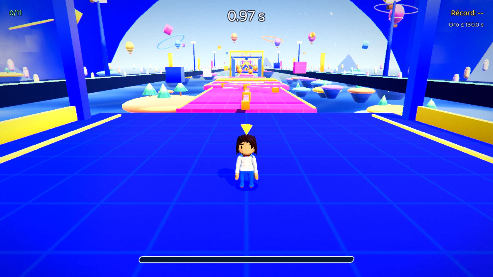
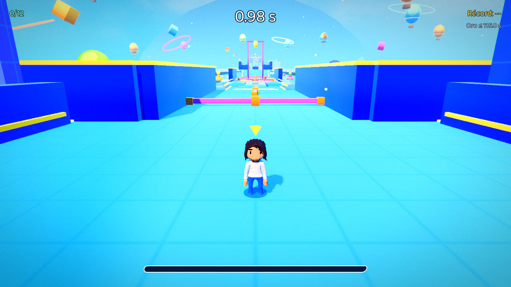
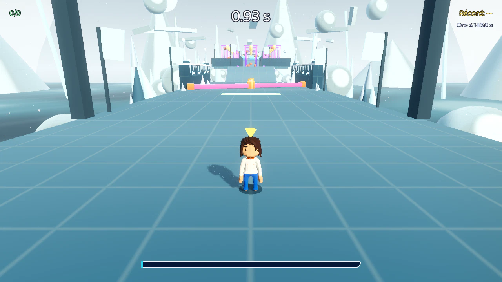
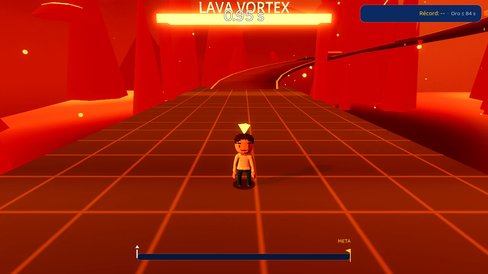
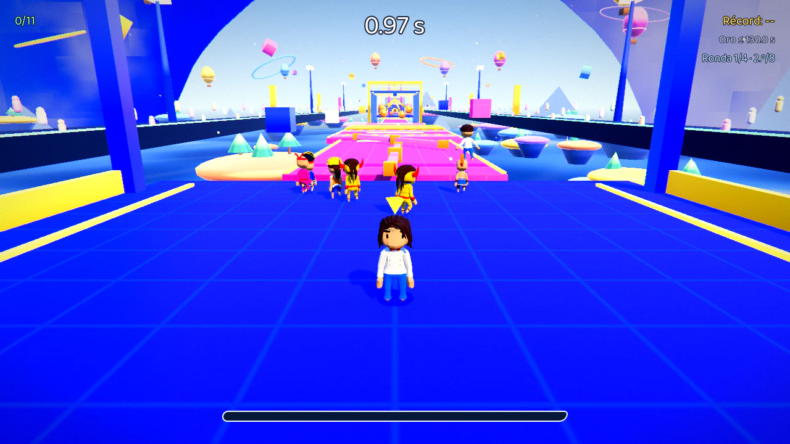
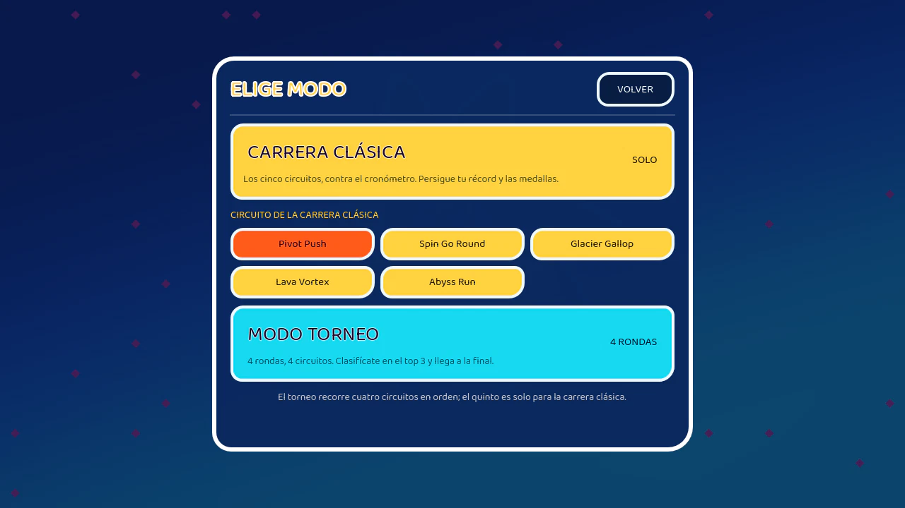

# Torneo de circuitos

**Alcance:** los cuatro circuitos del torneo y **Abyss Run** como carrera clásica; el archivo conserva su nombre original.

**Proyecto:** Tumble Rush
**Autores:** Pol Arjona e Yazan Issa
**Motor:** Godot Engine 4.7.2 (Forward Plus, Jolt)
**Fecha:** Noviembre 2026

---

## 1. Objetivo

El modo torneo recorre los circuitos del torneo, uno por ronda, unidos por `GameSession`. **Abyss Run** queda para la carrera clásica.

La tabla vigente de longitudes, checkpoints y medallas está en [Datos de referencia](Datos_circuitos.md#circuitos). Este informe ya no la copia.

Cada nivel lleva un `LevelInfo` con id, ronda, tiempos de medalla, récord propio, ruta de bots y anchos de carril. `RaceManager`, `RaceDirector` y el HUD leen esos datos, así que el mismo jugador y el mismo bot funcionan en todos los mapas.

**Pivot Panic se retiró.** Su escena ya no existe y su constructor está desactivado en `tools/build_levels.gd`; el torneo se cierra con los circuitos de la tabla.

## 2. Referencias y paletas

La composición y el color de los dos primeros circuitos se inspiraron en dos mapas **ajenos** de Stumble Guys de Sketchfab (CC-BY 4.0, autor **amogusstrikesback2**):

- [Pivot Push](https://sketchfab.com/3d-models/stumble-guys-pivot-push-map-c7abc0bdd0a8490d9f1e9c805e3c05cd)
- [Spin Go Round](https://sketchfab.com/3d-models/stumble-guys-spin-go-round-map-71224cc13db44948b91b8bb43c635d5c)

No se descargaron sus mallas: se usaron sus vistas previas para estudiar layout, familias de color y siluetas, y se construyeron circuitos originales con CSG, mallas y materiales del proyecto. Las dos vistas previas ajenas quedan en `documentacion/referencias/` con la misma atribución CC-BY 4.0; no son capturas del juego.

| Circuito | Base | Acentos | Cielo / mar |
| --- | --- | --- | --- |
| Pivot Push | azul real, magenta y rosa claro | oro, crema | azul profundo con islas pastel |
| Spin Go Round | cian y azul | naranja, magenta, lima, oro | turquesa luminoso con mar de nubes |
| Glacier Gallop | hielo, blanco y cian | azul profundo, oro | cielo gélido con niebla y nieve |
| Lava Vortex | negro volcánico y rojo | naranja, ámbar, ceniza | cielo rojizo con humo y meteoros |
| Abyss Run | turquesa y azul profundo | arena, coral, verde | fondo marino con niebla y luz de superficie |

Materiales nuevos: `pivot_floor`, `pivot_floor_alt`, `pivot_blue`, `pivot_gold`, `pivot_wall`, `pivot_rail`, `pivot_cream`, `spin_floor`, `spin_blue`, `spin_orange`, `spin_magenta`, `spin_lime`, `spin_gold`, `spin_wall` y `spin_hazard` (rayas de peligro con shader propio). El glaciar, el volcán y el abismo generan sus materiales en `level_builder.gd`.

### 2.1 Capturas propias

Todas las imágenes salen del render real del juego, con un perfil aislado. La galería completa está en [Capturas](Capturas.md).

<p align="center">
  
  
</p>
<p align="center">
  
  
</p>
<p align="center">
  
  
</p>

## 3. Pivot Push (ronda 1)

Es el circuito original, retematizado de azul/cian/lima a **azul real, magenta y oro**. Conserva los tramos y el balancín entre las cintas y la avenida de martillos. Los checkpoints y los bots siguen usando la misma ruta, expuesta en `LevelInfo`; el recuento está en [Datos de referencia](Datos_circuitos.md#circuitos).

**Acto 3 — la forja:** rampa de bajada al **pasillo de las rocas** (rocas persecutorias y cinta en contra), **terraza de pinchos**, **puente de las aspas** con tres brazos giratorios, **subida larga** hasta la cima con barrido y **dos péndulos**, y **bajada final** con dos barridos, cinta en contra y pinchos antes de la meta.

## 4. Spin Go Round (ronda 2)

Tres actos que alternan altura, persecuciones y obstáculos de suelo:

- **Acto 1 — arena y peonzas:** salida con arco y dos barridos en una arena con pasillos cerrados; pasarela estrecha y **plataforma móvil** sobre el vacío; tramo de peonzas con barrido, disco giratorio y lluvia de bolas.
- **Acto 2 — altura:** rampa de subida, **dos pistones** alternos con luz de aviso, **puente de 12 losas frágiles** y rampa de bajada.
- **Acto 3 — descenso y mirador:** **tres rocas persecutorias** en carriles desfasados, **galería de 16 pinchos** en 4 × 4, **puente de tres aspas**, cinta en contra, **subida al mirador** (24 m, +5,4 m) con lluvia de bolas, dos péndulos en la cima y bajada final con bolas y dos barridos.

## 5. Glacier Gallop (ronda 3)

El circuito de hielo. La primera mitad encadena barridos, **arena giratoria**, **ascensor de hielo**, galería de pistones y **puente de placas frágiles**. La segunda suma el **puente del vendaval** con viento cruzado, el **pasillo de rocas** y la **terraza de pinchos** antes de la recta final.

Sus dos rasgos exclusivos son los **muros de témpanos** (tres carriles que emergen y bajan con aviso, siempre queda uno abierto) y un **salto recortado** (impulso 5,02 en vez de 6,0) para que el hielo pese. La escena añade nieve, niebla, una catedral de hielo y decoración propia.

## 6. Lava Vortex (ronda 4)

La final es una **espiral de cuatro vueltas** alrededor de una montaña, con tres saltos sobre la lava; el desglose de producción está en [Datos de referencia](Datos_circuitos.md#recuentos-de-contenido).

- **Lava que sube** desde la base hasta la cima: el circuito se corre de una tirada.
- **Géiseres**, **lluvia de meteoros** con aviso, **vórtices de ceniza** y **cortinas de magma**.
- **Sin checkpoints**: una caída devuelve a la salida.
- La cámara puede seguir la espiral por muelle; el control actual es con ratón.

## 7. Abyss Run (carrera clásica)

Este circuito no entra en el torneo: se elige en la carrera clásica. Es un **túnel submarino** con islas secas, tramos de agua y checkpoints; la longitud y el recuento están en [Datos de referencia](Datos_circuitos.md#circuitos).

- **Nado:** flotabilidad, arrastre, inclinación del cuerpo y descenso con `Shift`/`Ctrl` o gatillo derecho.
- **Hazards marinos:** erizos, medusas, minas de burbujas, estrellas giratorias y aros de impulso.
- **Tramos:** islas, ascensores, pasos estrechos y paredes de roca con repisas.

## 8. Récords y medallas

Cada circuito guarda su propio récord y sus splits en `user://profile.json` (`best_times` y `best_splits_by_level`). Los tiempos de medalla son los de la [tabla de datos](Datos_circuitos.md#circuitos).

El HUD muestra el oro del circuito y, en torneo, la ronda y el puesto en un chip; el panel de resultados destaca el tiempo, la medalla y el puesto. Al clasificarse, «Siguiente ronda» avanza a la escena correspondiente; en la final el torneo se cierra.

## 9. Cómo se generan las escenas

- **Pivot Push:** construido a mano en `scenes/levels/pivot_push.tscn`.
- **Spin Go Round:** `tools/build_levels.gd` comparte el entorno (cielo, luces, postproceso, HUD, RaceManager, KillPlane, RaceDirector, jugador y pausa), construye cada plataforma y obstáculo y empaqueta el resultado en `scenes/levels/spin_go_round.tscn`.
- **Glacier Gallop, Lava Vortex y Abyss Run:** `scripts/levels/level_builder.gd` (modo `@tool`) genera el mapa al abrir la escena y lo hornea al guardar; después cada circuito se guarda en tres actos (`_act1..3.tscn`) que el nivel instancia. Ninguno se genera en runtime.

```bash
cd proyecto
godot --headless --path . res://tools/build_levels.tscn   # regenera Spin Go Round
```

## 10. Verificación

Resultados reales de la batería con Godot 4.7.2 (`bash tools/run_tests.sh`). El recuento de tests, las escenas comprobadas y los tiempos de los tests largos están en [Datos de referencia](Datos_circuitos.md#verificacion). La suite obligatoria incluye `levels_test`, `lod_test`, `flow_test`, `features_test`, `iteration3/4/5` y `check_docs`; los tests de bots (`--long`) van en el job aparte.

## 11. Uso de inteligencia artificial

La IA (Freebuff, de Codebuff) se ha usado para revisar el estado real del proyecto frente a la documentación, describir los circuitos con datos verificados (escenas, `LevelInfo`, checkpoints y medallas), ejecutar la batería headless y anotar con precisión qué pasa y qué falla. Todos los datos de este informe salen del código y de los tests. El detalle del uso de IA de la entrega está en `Segunda_iteracio.md` (sección 7).

## 12. Créditos

- Referencias de composición **ajenas**: Pivot Push y Spin Go Round de **amogusstrikesback2** en Sketchfab, **CC-BY 4.0** (vistas previas en `documentacion/referencias/`).
- Capturas propias: [Capturas](Capturas.md), generadas con `proyecto/tools/capture_docs.gd`.
- Pelota de playa: [beach ball](https://poly.pizza/m/4IwPTeOmq6c) de **the_ normalgamer**, **CC-BY 3.0** (ver `proyecto/assets/props/README.md`).
- Personajes: [Ultimate Animated Character Pack](https://quaternius.com/packs/ultimatedanimatedcharacter.html) de **Quaternius**, **CC0**.
- Tipografía: **Baloo 2** de Ek Type, **SIL OFL 1.1**.
